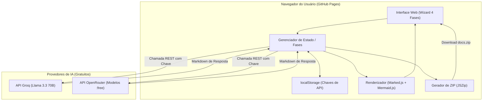
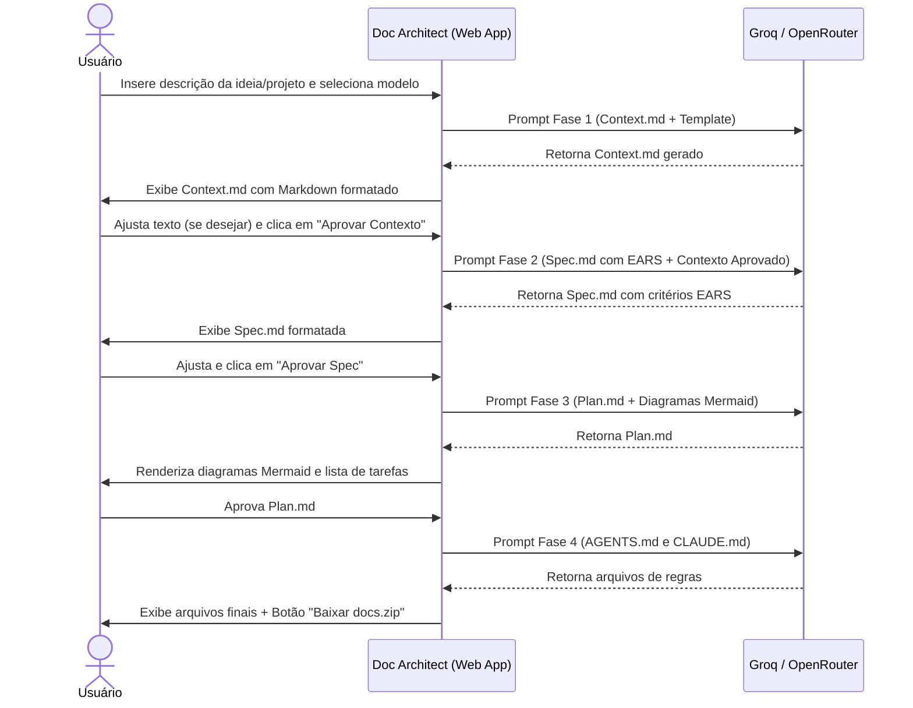

# Design — Doc Architect (Web & Spec-Driven)

## Visão geral

O **Doc Architect** é uma **SPA (Single Page Application)** estática projetada para rodar diretamente no navegador e ser hospedada no **GitHub Pages**. A aplicação implementa um assistente passo a passo (wizard) que orquestra as 4 fases do fluxo spec-driven comunicando-se diretamente com provedores de IA gratuitos (**Groq** e **OpenRouter**).

---

## Decisões Técnicas

| Decisão | Escolha | Motivo |
|---|---|---|
| **Plataforma** | Web SPA estática (HTML5 / Tailwind CSS / Vanilla JS moderno) | Sem build complexo obrigatório, carrega instantaneamente no GitHub Pages e funciona em qualquer computador. |
| **Hospedagem** | GitHub Pages (repositório público/privado) | Custo zero, CDN global, HTTPS nativo e acessível de qualquer dispositivo. |
| **Provedores de IA** | **Groq API** e **OpenRouter API** | Oferecem modelos excelentes de graça (Groq: `llama-3.3-70b-versatile`; OpenRouter: modelos com sufixo `:free`), suportam chamadas REST com CORS direto do navegador. |
| **Segurança das Chaves** | `localStorage` no navegador (BYOK — *Bring Your Own Key*) | Nenhuma chave transita por servidores intermediários; cada máquina armazena sua chave localmente. |
| **Renderização Markdown** | `marked.js` + `highlight.js` | Rápido, leve e com destaque de sintaxe limpo. |
| **Renderização de Diagramas**| `mermaid.js` | Renderiza fluxogramas e sequências visuais diretamente na tela do plano técnico. |
| **Exportação de Arquivos** | `JSZip` + `FileSaver` | Gera o arquivo `.zip` com a estrutura exata de pastas do projeto no cliente sem backend. |

---

## Arquitetura do Sistema



---

## Fluxo das Fases e Gates de Aprovação



---

## Estrutura da Aplicação

```
Docs_Mds/
├── index.html                   ← Interface única (UI, painel de chaves, fases, editor/visualizador)
├── css/
│   └── styles.css               ← Estilização complementar (modo escuro/claro, layout responsivo)
├── js/
│   ├── app.js                   ← Controlador principal da aplicação e eventos
│   ├── config.js                ← Configurações e modelos suportados (Groq e OpenRouter)
│   ├── api.js                   ← Cliente HTTP para chamadas aos provedores com streaming/fallback
│   ├── prompts.js               ← Geradores de prompts rigorosos baseados nos templates
│   └── export.js                ← Empacotador ZIP com a árvore de diretórios correta
├── templates/                   ← Templates canônicos mantidos no repositório
├── specs/doc-architect/         ← Documentação do próprio projeto
└── README.md                    ← Documentação e guia de publicação no GitHub Pages
```

---

## Tratamento de Casos e Erros

| Cenário | Comportamento do Sistema |
|---|---|
| **Chave ausente ou inválida** | Modal orienta o usuário a obter chave gratuita no console do Groq ou OpenRouter e bloqueia requisições até o preenchimento. |
| **Limite de taxa (Rate Limit - 429)** | Exibe alerta amigável sugerindo aguardar alguns segundos ou alternar para outro modelo/provedor gratuito. |
| **Erro na sintaxe Mermaid** | Fallback seguro que exibe o bloco de código Markdown do diagrama se o parser do Mermaid encontrar algum erro de sintaxe. |
| **Edição manual pelo usuário** | Todo documento gerado possui abas "Visualizar" e "Editar (Raw Markdown)", permitindo ajustes finos antes da aprovação. |
| **Tentativa de pular fase** | As fases subsequentes permanecem desabilitadas até que a fase atual receba o clique de aprovação. |
