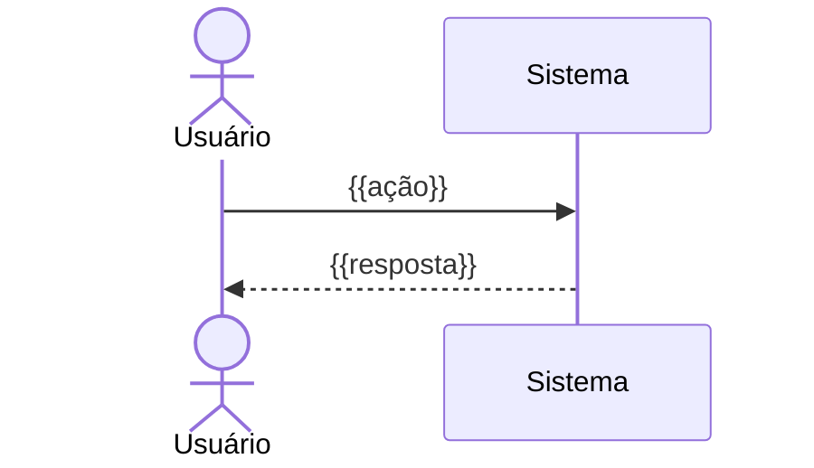

# Plan — {{NOME_DA_FEATURE}}

> Consolida o design técnico e o checklist de tarefas. Gerado a partir de `Spec.md` **aprovada**.
> Status: `rascunho` | `aprovado` | `em execução` | `concluído`

# Parte A — Design

## Visão geral
{{abordagem em 3–5 linhas}}

## Arquitetura
```mermaid
flowchart LR
    UI[{{Interface}}] --> API[{{Serviço}}] --> DB[({{Banco}})]
```

## Componentes
| Componente | Responsabilidade | Arquivo(s) previsto(s) | Requisitos |
|---|---|---|---|
| | | | R1 |

## Modelo de dados
```
{{Entidade}}
  - campo: tipo  (regra)
```

## Interfaces / contratos
| Método | Rota / assinatura | Entrada | Saída | Erros |
|---|---|---|---|---|
| | | | | |

## Fluxo principal


## Tratamento de erros
| Cenário | Comportamento | Requisito |
|---|---|---|
| | | |

## Estratégia de testes
- **Unitários:** {{o quê}}
- **Integração:** {{o quê}}
- **Aceite:** cada critério EARS da Spec vira ao menos um teste.

## Riscos e alternativas descartadas
- {{risco}} → {{mitigação}}

# Parte B — Tarefas

> Regras: uma tarefa = um commit. Siga a ordem. Cite os requisitos. Não comece a próxima sem os testes da atual passando.

- [ ] 1. {{Preparar base / estrutura}}
  - {{detalhe}}
  - _Requisitos: R1.1_
- [ ] 2. {{Implementar componente X}}
  - [ ] 2.1 {{subtarefa}} — _Requisitos: R1.2_
  - [ ] 2.2 {{testes de X}} — _Requisitos: R1.2_
- [ ] 3. {{Integrar}}
  - _Requisitos: R2.1_
- [ ] 4. Conferir todos os critérios EARS da Spec

## Definição de pronto
- [ ] Todos os critérios de aceite da Spec cobertos por testes
- [ ] Lint e testes passando
- [ ] `docs/Context.md` atualizado se a estrutura ou a stack mudaram
